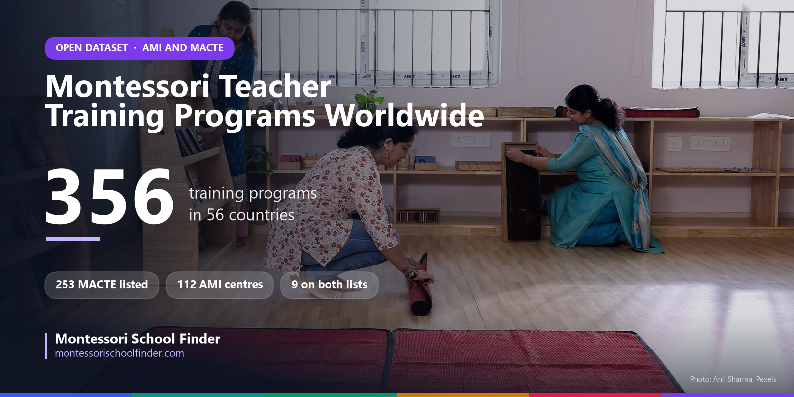
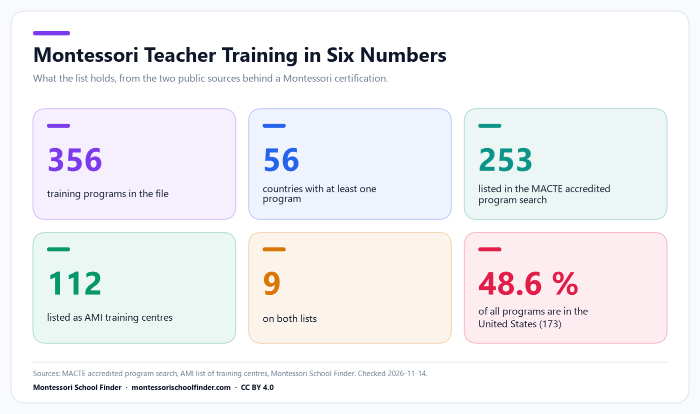
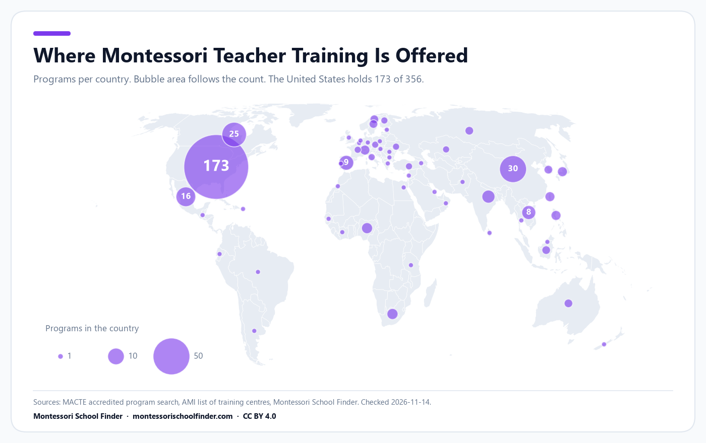
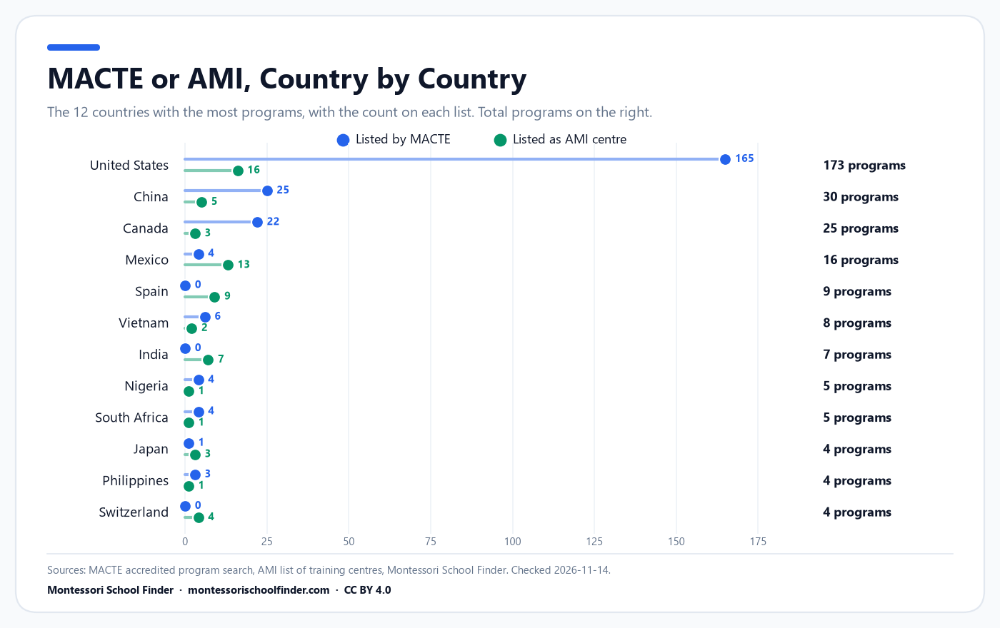
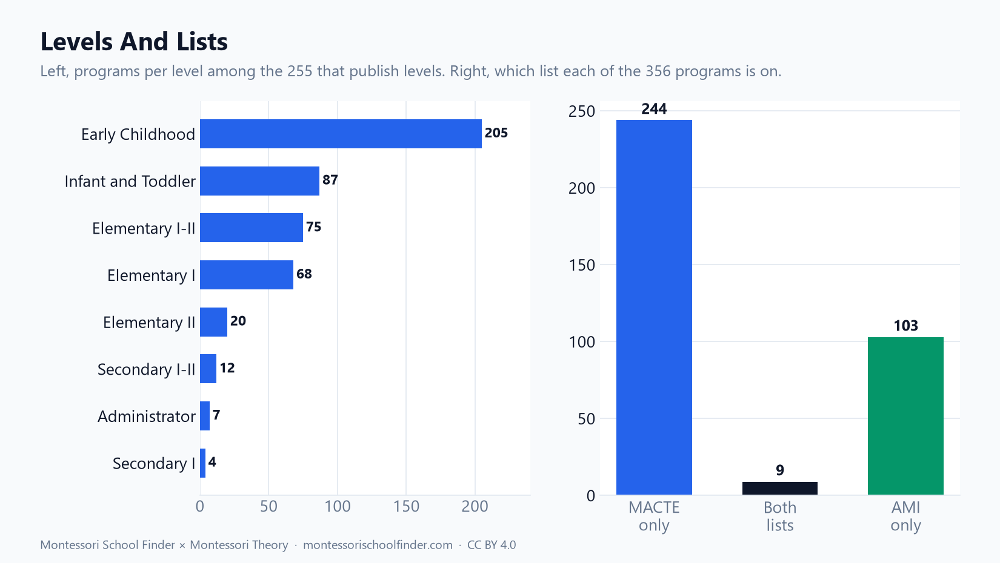

# Montessori Teacher Training Programs Worldwide

[](https://creativecommons.org/licenses/by/4.0/) [](https://www.kaggle.com/datasets/mariamontessori/montessori-teacher-training-programs) [](https://huggingface.co/datasets/montessoritheory/montessori-teacher-training-programs)



**English first, version française plus bas, resumen en español al final.**

An open, documented list of the Montessori teacher training programs we hold, **356 programs in 56 countries**, from the two public sources that matter for a Montessori certification, the **MACTE accredited program search** and the **AMI list of training centres**. Each row has the program name, city, country, levels, affiliation, delivery format, accreditation status, website and a link to its page on [Montessori School Finder](https://www.montessorischoolfinder.com/montessori-certifications/training-centers/), the companion school directory. Published by [Montessori School Finder](https://www.montessorischoolfinder.com/).

If you are asking how to become a Montessori teacher, which Montessori certification fits you, or where the AMI training centres and MACTE accredited programs are, this is the table behind those answers.

## Find A Program Or Use The Data

- **Looking for a program?** Browse the same list by country, with a map, on [Montessori School Finder](https://www.montessorischoolfinder.com/montessori-certifications/training-centers/).
- **Want the Montessori side of the story?** Read our guide to [AMI versus AMS](https://www.montessorischoolfinder.com/guides/ami-vs-ams/), or browse the [Montessori certifications](https://www.montessorischoolfinder.com/montessori-certifications/) section of Montessori School Finder.
- **Building something?** Take the CSV files in `data/`, the column list in `data_dictionary.csv` or the starter notebook.

### The Headline Numbers

|  |  |
|---|---|
| Training programs in the file | 356 |
| Countries | 56 (19 with three programs or more) |
| Listed by MACTE | 253 (249 with full accreditation, 4 with another status) |
| Listed as AMI training centres | 112 |
| On both lists | 9 |
| MACTE only / AMI only | 244 / 103 |
| Largest countries | United States 173, China 30, Canada 25, Mexico 16, Spain 9 |
| Share in the United States | 48.6 % |
| Levels (255 programs publish them) | Early Childhood 205, Infant and Toddler 87, Elementary 91, Secondary 13 |
| MACTE programs by delivery | 104 mostly in person, 74 with 10 to 50 % online, 71 with more than 50 % online, 4 not published |
| Last checked | 2026-11-14 |









### Files

| file | content |
|---|---|
| `data/programs.csv` | 356 rows, one per training program, the main file |
| `data/by_country.csv` | 56 rows, programs per country with MACTE and AMI counts and the Montessori School Finder page |
| `data/by_level.csv` | 10 rows, programs per level, plus the programs that publish no level |
| `data/by_accreditation.csv` | 5 rows, programs by list and MACTE status, adds up to 356 |
| `data_dictionary.csv` | every column of every file |
| `scripts/` | the code that rebuilds the tables, charts and cover from the three source files |
| `notebooks/starter.ipynb` | a starter notebook, already executed |

### Columns Of `programs.csv`

| column | description |
|---|---|
| `program_id` | Stable id built from country, city and program name |
| `name`, `city`, `state_province`, `country`, `country_slug` | Program name and place as published, the slug is the one used in the Montessori School Finder URL |
| `listed_by` | `MACTE`, `AMI` or `MACTE and AMI` |
| `macte_listed`, `ami_listed` | The program appears in the MACTE search or in the AMI list |
| `macte_status` | `Full Accreditation`, `Other MACTE status (probation or withdrawn)` or `Not listed by MACTE` |
| `macte_sites` | Number of MACTE site and level entries behind the program |
| `affiliation` | Association given by MACTE (AMS, AMI, MEPI, IMC, NCMPS, MA, IAPM, PAMS, CMF, Independent) |
| `delivery_format` | MACTE delivery format, share of online hours |
| `levels`, `levels_published` | Levels as `;` separated names, and whether any level is published |
| `level_infant_toddler`, `level_early_childhood`, `level_elementary`, `level_secondary` | One flag per level family |
| `website`, `macte_url` | The program's own website and its MACTE page |
| `latitude`, `longitude` | City centre, not a street address, empty for 9 programs |
| `msf_url`, `msf_url_type` | Link to the country page on Montessori School Finder, or to the all-countries hub when the country has fewer than three programs |
| `last_checked` | Date of the last collection |

The other files are described column by column in `data_dictionary.csv`.

### Load It

```python
import pandas as pd

base = "https://raw.githubusercontent.com/montessoritheory/montessori-teacher-training-programs/main/data"
programs = pd.read_csv(f"{base}/programs.csv")
programs.groupby("country").size().sort_values(ascending=False).head(10)

programs.query("level_early_childhood and listed_by != 'AMI'")[["name", "city", "country", "msf_url"]]
```

### How It Was Built

The MACTE accredited program search and the AMI list of training centres were read in November 2026. Each program was merged across the two lists when its name and city, or its website and city, matched. The AMI list gives age bands as free text, so they were mapped to the MACTE level names (0 to 3 to Infant and Toddler, 3 to 6 to Early Childhood, 6 to 12 to Elementary I-II, 12 to 18 to Secondary I-II). City centres were geocoded for the map. The AMI/USA office and an alumni association were removed because they are not training programs. `scripts/build_programs.py` rebuilds every table and `scripts/make_outputs.py` the charts and cover.

### Checked Against The Source

- The three summary files add up to the program file. Countries sum to 356, accreditation groups to 356, and the levels file gives 255 programs with levels and 101 without.
- 10 rows drawn across countries were compared with the raw MACTE and AMI collection, with the same name, city, website and levels.
- Every row has a country and a link to Montessori School Finder.

### Read With Care

- **A snapshot, not a registry.** Programs open, close and change accreditation. Check dates, fees and entry rules with each program.
- **Accreditation is MACTE's word.** `macte_status` copies what the MACTE search shows. A program with no MACTE listing may still be recognized elsewhere, and AMI centres issue AMI diplomas under AMI rules.
- **Level names differ by source.** MACTE uses codes such as EC and EL I-II. AMI gives age bands, mapped here to the nearest MACTE level. 101 of the 103 AMI-only centres publish no level at all.
- **One organization can have several rows.** A training center with satellite locations or several cities is listed once per place.
- **Coordinates are city centres.** They are for maps and counts, not for navigation.
- **Coverage.** This is the list we hold, built from two public sources. Other programs exist, for example in countries where neither body lists one.

### Image Credits

Cover photo by Anil Sharma on [Pexels](https://www.pexels.com/photo/40282976/), Pexels License. World outlines in the map from [Natural Earth](https://www.naturalearthdata.com/), public domain. Charts by Montessori School Finder.

### License And Citation

**[CC BY 4.0](https://creativecommons.org/licenses/by/4.0/)**. Use it, share it and adapt it, commercially or not, and credit **Montessori School Finder** with a link to **[montessorischoolfinder.com](https://www.montessorischoolfinder.com/)**, along with the sources below.

```bibtex
@misc{montessorischoolfinder_montessori_teacher_training_programs_2026,
  title  = {Montessori Teacher Training Programs Worldwide},
  author = {{Montessori School Finder}},
  year   = {2026},
  url    = {https://github.com/montessoritheory/montessori-teacher-training-programs},
  note   = {Dataset, version 1.0, compiled from the MACTE accredited program search and the AMI list of training centres}
}
```

Sources. [MACTE accredited programs](https://www.macte.org/accredited-programs/) and [AMI training centres](https://montessori-ami.org/training-programmes/training-centres), public listings read in November 2026. Program names, websites and the MACTE and AMI marks belong to their owners.

Also on **[Kaggle](https://www.kaggle.com/datasets/mariamontessori/montessori-teacher-training-programs)**, with a starter notebook, and on **[Hugging Face](https://huggingface.co/datasets/montessoritheory/montessori-teacher-training-programs)**, ready for the `datasets` library.

---

## Version Française

### Les formations Montessori pour enseignants dans le monde

Ce jeu de données ouvert rassemble **356 formations Montessori pour enseignants dans 56 pays**, tirées de la recherche publique des programmes accrédités MACTE et de la liste des centres de formation AMI. Chaque ligne donne le nom, la ville, le pays, les niveaux, l'affiliation, le format (présentiel ou en ligne), le statut d'accréditation, le site web et un lien vers la page du pays sur [Montessori School Finder](https://www.montessorischoolfinder.com/montessori-certifications/training-centers/).

- 253 programmes sont listés par MACTE et 112 sont des centres AMI. 9 figurent sur les deux listes.
- Les États-Unis comptent 173 programmes, devant la Chine (30), le Canada (25) et le Mexique (16).
- Les coordonnées sont celles du centre de la ville, pas d'une adresse.

Licence CC BY 4.0, en citant **Montessori School Finder** ([montessorischoolfinder.com](https://www.montessorischoolfinder.com/)), ainsi que MACTE et AMI comme sources.

### Resumen

356 programas de formación Montessori para docentes en 56 países, a partir de la búsqueda pública de programas acreditados por MACTE y de la lista de centros de formación AMI. 253 figuran en MACTE, 112 son centros AMI y 9 están en ambas listas. Estados Unidos reúne 173, seguido de China (30), Canadá (25) y México (16). Licencia CC BY 4.0, con crédito a Montessori School Finder.

---

**Part of the [Montessori School Finder open datasets](https://github.com/montessoritheory/montessori-schools-open-data).** Directory and guides at [montessorischoolfinder.com](https://www.montessorischoolfinder.com/).
